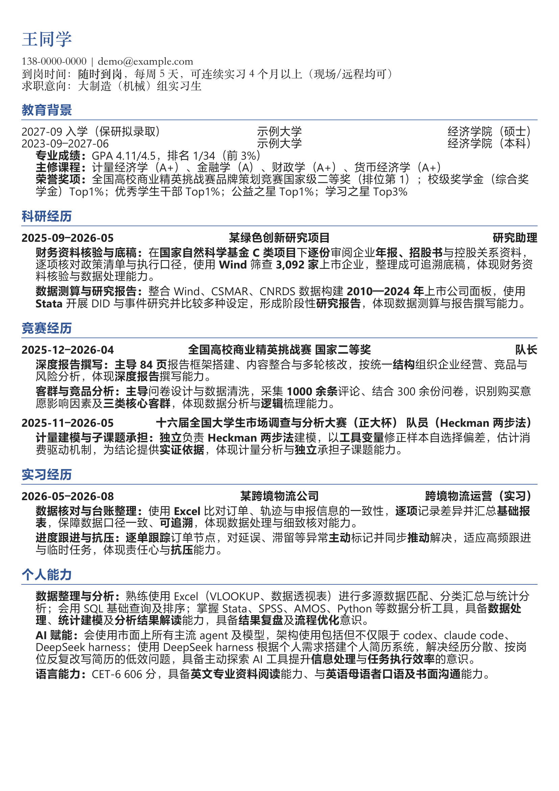

# 个人 AI 简历系统

[English](README.en.md)

**把经历，变成一份能投的简历。**

> 整理经历、匹配岗位、写简历这些"动脑"的事，由你自己的 AI 助手（Claude Code / Cursor / …）完成；本仓库提供结构、校验和排版。

## 你可能有这些烦恼

- 手上有一堆实习、项目、竞赛材料，但每投一个岗位就得重新拼一版简历。
- 不知道该把哪几段放上去，才能对上这个岗位的要求。
- 让 AI 直接写，读着挺漂亮，但面试官一问"这个数据哪来的"，自己都答不上来。

## 它能帮你做什么

1. **整理一次，以后反复用。** 把简历草稿、实习证明、项目报告、课程作业拆成一条条"真实发生过的事"，放进经历库。以后投任何岗位都能调用。
2. **对着岗位，挑出最相关的经历。** 贴上岗位 JD，判断岗位真正要什么能力，再从经历库里挑出最能证明的几段，而不是把所有经历都堆上去。
3. **按岗位重新组织表达。** 不是原样搬，而是针对岗位调整：哪段放前面、强调什么、怎么一句话说清"我做了什么、带来什么结果"。
4. **一键排成一页，直接投。** 排好版、控制在一页，导出 Word / PDF / 图片。不用再自己调格式。

## 你会拿到

- 一份**一页简历**（Word，可转 PDF / 图片）
- 一份**分析**：岗位要什么、你哪段对上了、还缺什么
- 一个**经历库**：下次投别的岗位，不用从零开始



## 它和"让 AI 直接写简历"有什么不同

- **每句话有据可查**：简历里的内容都能对应到你某段真实经历，不是 AI 编的。
- **你说了算**：哪些经历能用、哪些细节准确，由你确认。
- **看得见缺口**：岗位要的能力你没有证据，它会直说"这块你缺"，而不是硬写漂亮话。

## 它不做什么

- 不替你编经历、编数字。
- 不支持扫描件、图片（需要先转成文字）。
- 目前只做**一页中文简历**。
- 不保证"提高通过率"——这个没有数据支撑；它保证的是"每句有据、针对岗位、格式干净"。

## 怎么开始

**方式一：用你已有的 AI 助手（推荐）**

1. 把材料放进 `data/raw/`，或让工具帮你把 docx/pdf 转成文字：`python tools/ingest.py 材料.docx`
2. 用你平时用的 AI 助手，按 `schemas/` 和 `docs/` 把经历整理进经历库
3. `python tools/validate.py` 校验
4. 贴一个岗位 JD，让 AI 助手生成简历，再跑 `python -m resume_system.export.docx_export --task <任务id> --pdf --png`

完整流程见 [docs/agent_usage.md](docs/agent_usage.md)。

**方式二：先看 demo（不用 AI、不用 key）**

```bash
pip install -e .
RESUME_DATA_DIR=examples/demo/data RESUME_OUTPUT_DIR=/tmp/demo_out \
python -m resume_system.export.docx_export --task demo-render --pdf --png
```

## 目录结构

```
resume-system/
├── config/
│   ├── abilities.yaml          # JD 解析用的能力词表
│   ├── categories.yaml         # 经历板块（实习/项目/竞赛/科研/校园…）
│   └── style.yaml              # 排版（字体/字号/间距/边距/照片/主题）
├── schemas/                    # JSON Schema（校验数据 + 约束 agent 产出）
├── data/                       # 事实唯一来源（纯 JSON；不进公开仓库）
│   ├── raw/                    #   原始材料原件（只读）
│   ├── knowledge_base/         #   长期知识库
│   └── jobs/                   #   单次求职任务工作区（每份投递一个）
├── src/resume_system/
│   ├── export/                 # DOCX 渲染器（resume_json -> 排好版的 Word）
│   ├── review.py               # 字条重合检查（不调模型）
│   ├── keyword_check.py        # JD 关键词覆盖检查（不调模型）
│   ├── checks.py               # 发布前检查（荣誉/教育/板块/P0 覆盖）
│   └── prompts/                # 提示词（给 agent 参考，与代码分离）
├── output/                     # 简历成稿输出（.docx/.pdf/.png；不进公开仓库）
├── examples/                   # 5 个虚构行业 demo（电商/金融/咨询/数据/法务）
└── tools/                      # 维护脚本（ingest / validate）
```

## 安装

需要 Python ≥ 3.10。

```bash
pip install -e .
pip install -e ".[dev]"   # 跑测试
pytest -q
```

导出 PDF/PNG 需要 LibreOffice（`soffice`），PNG 还需要 `mutool` 或 `pdftoppm`；只出 docx 不需要。

## 校验 / 查重

```bash
# 改完 data/ 后必跑：schema + 跨文件引用 + 任务引用 + resume_json
python tools/validate.py

# 查重：同一段经历里字条能力/措辞重合（不调模型）
python -m resume_system.review --task <任务id>

# 关键词覆盖：JD 提到、简历里没出现的能力词
python -m resume_system.keyword_check --task <任务id>
```

## 排版与个性化

| 想改什么 | 改哪里 |
|---|---|
| 字体 / 字号 / 颜色 / 边距 / 行距 / 制表位 / 照片高度 | `config/style.yaml` |
| 配色主题（finance / consulting / tech / minimal） | `config/style.yaml` 的 `theme` |
| 模块顺序、是否显示照片/到岗/意向 | `config/style.yaml` 的 `layout` |
| 经历板块类型、标题、顺序 | `config/categories.yaml` |
| JD 解析的能力词表 | `config/abilities.yaml` |
| 个人能力固定文案 | `data/profile_blocks.yaml` |
| 补充 few-shot | `data/few_shot.md` |
| 通用表达偏好 | `data/preferences.json` |

改完重新生成或重新渲染即可，不用动代码。`data/` 下的文件不进公开仓库。

字体要求：默认用「微软雅黑」和「宋体-简」，本机没有会 fallback；换字体改 `config/style.yaml` 即可。

## 测试

```bash
pip install -e ".[dev]"
pytest -q
```

CI 见 `.github/workflows/tests.yml`，不依赖模型和 LibreOffice（渲染测试只生成 docx，不数页）。

## 限制

- 版式是为**中文一页简历**设计的（A4、单页、微软雅黑/宋体）；多页或英文简历要改 `config/style.yaml` 和裁页逻辑
- 未接 OCR：扫描件/图片抽不出文字，`tools/ingest.py` 会警告
- 生成质量依赖你自己的 agent/模型，本仓库只保证结构、格式和可核对性

## 文档索引

| 文件 | 作用 |
|---|---|
| `docs/agent_usage.md` | **给 agent 的完整流程** |
| `docs/architecture.md` | 架构与数据流 |
| `docs/layout_spec.md` | 排版规范（栏目、字体、字号、顺序） |
| `docs/style_rules.md` | 简历字条语言规则（抽象版，无真实案例） |
| `docs/experience_template.md` | 经历采集固定模板（A 用） |

## 隐私边界

- `data/`、`output/` 在 `.gitignore` 里：真实知识库、原始材料、照片、任务、成稿**都不会进公开仓库**
- 私有文案也在 `data/`：`profile_blocks.yaml`（个人能力三条）、`few_shot.md`、`preferences.json`
- 公开仓库只包含引擎、schema、抽象规则和 `examples/` 的**虚构数据**
- 想让程序读别的数据目录：`RESUME_DATA_DIR=/path/to/private/data`

## License

MIT，见 [LICENSE](LICENSE)。
